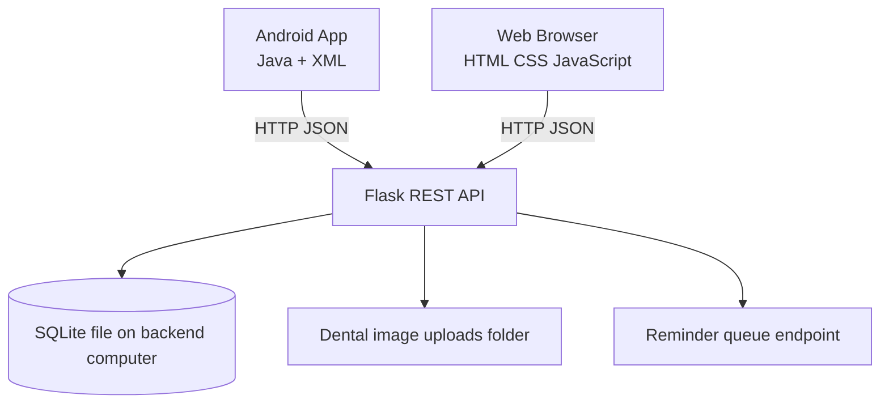
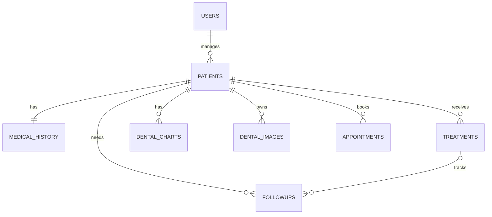

# Architecture diagram

## ER diagram

## Data flow
1. User signs in through Android or web browser.
2. Client sends authenticated requests to Flask.
3. Flask validates input and performs parameterized SQLite queries.
4. Patient image bytes are saved under `backend/uploads`; metadata is linked to patient in SQLite.
5. Both clients retrieve the same patient and appointment records from the server.
